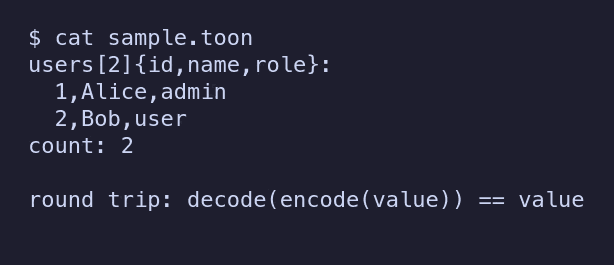

# Showcase

Every image below is real output of the code in this repository on generic
sample data (two users and a count). Nothing is mocked up.

## Encode and decode the sample



Source: [`showcase/demo.bend`](showcase/demo.bend). It builds the value, prints
`Toon.encode` of it, then decodes that text and checks it equals the value.

Reproduce, from the repository root (bend 2.0.38, ImageMagick):

```
sh docs/showcase/make-screenshots.sh
```

That runs `bend docs/showcase/demo.bend` and renders its output to
`docs/showcase/encode-sample.png`. To see the text alone: `bend docs/showcase/demo.bend`.
